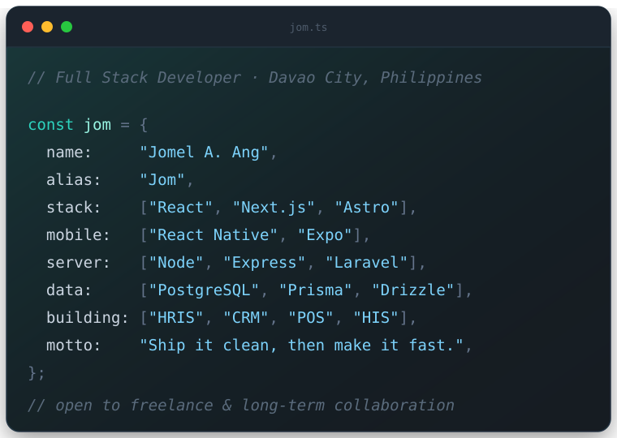
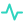

<!-- ══════════════════ HERO ══════════════════ -->

  

  <a href="https://jaang.dev">
    <picture>
      <source media="(prefers-color-scheme: dark)" srcset="https://readme-typing-svg.demolab.com?font=JetBrains+Mono&weight=600&size=20&pause=1000&center=true&vCenter=true&width=650&color=2DD4BF&lines=Software+Engineer+%40+Global+Telemedicine+Corporation;HRIS+%C2%B7+CRM+%C2%B7+POS+%C2%B7+Hospital+Information+Systems;Laravel+%C2%B7+React+%C2%B7+Next.js+%C2%B7+Node.js+%C2%B7+PostgreSQL;From+Figma+spec+to+production+deploy;Open+for+freelance+%26+full-time+projects" />
      <source media="(prefers-color-scheme: light)" srcset="https://readme-typing-svg.demolab.com?font=JetBrains+Mono&weight=600&size=20&pause=1000&center=true&vCenter=true&width=650&color=0F766E&lines=Software+Engineer+%40+Global+Telemedicine+Corporation;HRIS+%C2%B7+CRM+%C2%B7+POS+%C2%B7+Hospital+Information+Systems;Laravel+%C2%B7+React+%C2%B7+Next.js+%C2%B7+Node.js+%C2%B7+PostgreSQL;From+Figma+spec+to+production+deploy;Open+for+freelance+%26+full-time+projects" />
      
    </picture>
  </a>

  
  
  

 

<!-- ══════════════════ ABOUT ══════════════════ -->

## &nbsp; About Me

  

- &nbsp; **Software Engineer at Global Telemedicine Corporation** since 2024. I build and maintain telemedicine and hospital systems end to end, from system design to deployment and monitoring, with Laravel, React, AWS and Docker.
- &nbsp; I build **enterprise systems for the Philippine market**: HRIS, CRM, POS and hospital information systems with role-based access, including the unglamorous parts like **SSS / PhilHealth / Pag-IBIG / TRAIN Law payroll math**, multi-branch inventory and PhilHealth claims.
- &nbsp; Web *and* mobile: **React + Vite** in the browser, **React Native + Expo** on the phone, one shared API underneath.
- &nbsp; I have a background in graphic and UI/UX design, so a Figma spec comes out pixel-faithful.
- &nbsp; Currently studying for a **Master in Information Technology** at the University of Southeastern Philippines.
- &nbsp; Portfolio → **[jaang.dev](https://jaang.dev)**

 

<!-- ══════════════════ STACK ══════════════════ -->

## &nbsp; Tech Stack

<table>
  <tr>
    <td><b>Languages</b></td>
    <td>
      
      
      
      
      
      
      
    </td>
  </tr>
  <tr>
    <td><b>Frontend</b></td>
    <td>
      
      
      
      
      
      
      
    </td>
  </tr>
  <tr>
    <td><b>Mobile</b></td>
    <td>
      
      
    </td>
  </tr>
  <tr>
    <td><b>Backend</b></td>
    <td>
      
      
      
      
      
      
    </td>
  </tr>
  <tr>
    <td><b>Data</b></td>
    <td>
      
      
      
      
      
      
    </td>
  </tr>
  <tr>
    <td><b>DevOps &amp; Tools</b></td>
    <td>
      
      
      
      
      
      
      
    </td>
  </tr>
</table>

 

<!-- ══════════════════ PROJECTS ══════════════════ -->

## &nbsp; Selected Work

<table>
  <tr>
    <td width="50%" valign="top">
      <h3>IHP HRIS</h3>
      
Human resource information system for a Philippine corporation: a web dashboard plus a companion mobile app, sharing one TypeScript API.

      

        
        
        
        
      

    </td>
    <td width="50%" valign="top">
      <h3>mycrm</h3>
      
Personal CRM layered onto my portfolio: clients, projects, payments and visitor analytics, plus a read-only guest mode and role-scoped contact logins.

      

        
        
        
        
      

      
<a href="https://mycrm-alpha.vercel.app/"><b>Live demo →</b></a>

    </td>
  </tr>
  <tr>
    <td width="50%" valign="top">
      <h3>GTC Imaging</h3>
      
Hospital information system frontend with real-time updates, telemedicine video and PhilHealth integration.

      

        
        
        
      

    </td>
    <td width="50%" valign="top">
      <h3>Client Websites</h3>
      
Fast, design-faithful websites built from Figma specs:
        <a href="https://www.chicane.com/">Chicane</a> (supper club),
        <a href="https://custom-cookies.vercel.app/">Mary Lou's Custom Cookies</a> (online shop),
        <a href="https://artisan-tile.vercel.app/">Artisan Tile &amp; Stone</a> (lead generation) and
        <a href="https://abs-v1.vercel.app/">Advanced Business Suite</a> (business services).

      

        
        
        
      

    </td>
  </tr>
  <tr>
    <td width="50%" valign="top">
      <h3>UI/UX &amp; Graphic Design</h3>
      
Product UI and web design work, including the
        <a href="https://www.behance.net/gallery/189465813/Web-UIUX-Product-Design">Vintesse</a> web UI/UX case study and the
        <a href="https://www.behance.net/gallery/189602597/Bannerfolio-2023">Bannerfolio</a> banner collection.

      

        
        
      

      
<a href="https://www.behance.net/jomelang"><b>More on Behance →</b></a>

    </td>
    <td width="50%" valign="top">
      <h3>jaang.dev</h3>
      
My portfolio: a React 19 single-page app with work history, project showcase and live availability, deployed on Cloudflare Workers.

      

        
        
        
        
      

      
<a href="https://jaang.dev"><b>Visit →</b></a>

    </td>
  </tr>
</table>

 

<!-- ══════════════════ ACTIVITY ══════════════════ -->

## &nbsp; GitHub Activity

  <picture>
    <source media="(prefers-color-scheme: dark)" srcset="https://streak-stats.demolab.com?user=JomsWick&hide_border=true&background=161C24&stroke=1E3A3A&ring=2DD4BF&fire=5EEAD4&currStreakNum=F8FAFC&sideNums=5EEAD4&currStreakLabel=5EEAD4&sideLabels=CBD5E1&dates=94A3B8" />
    <source media="(prefers-color-scheme: light)" srcset="https://streak-stats.demolab.com?user=JomsWick&hide_border=true&background=F0FDFA&stroke=99F6E4&ring=0D9488&fire=0D9488&currStreakNum=042F2E&sideNums=0F766E&currStreakLabel=0F766E&sideLabels=334155&dates=64748B" />
    
  </picture>

<!--
  Contribution snake: generated by .github/workflows/snake.yml into the
  "output" branch. It stays blank until that workflow has run at least once.
-->

  <picture>
    <source media="(prefers-color-scheme: dark)" srcset="https://raw.githubusercontent.com/JomsWick/JomsWick/output/github-snake-dark.svg" />
    <source media="(prefers-color-scheme: light)" srcset="https://raw.githubusercontent.com/JomsWick/JomsWick/output/github-snake.svg" />
    
  </picture>

 

<!-- ══════════════════ CONTACT ══════════════════ -->

## &nbsp; Let's Build Something

  Open for freelance and full-time projects, product work and long-term collaborations. 
  Based in Davao City, Philippines · Mon–Fri, 8 AM–5 PM (GMT+8) · working with teams anywhere.

  
  
  

  

